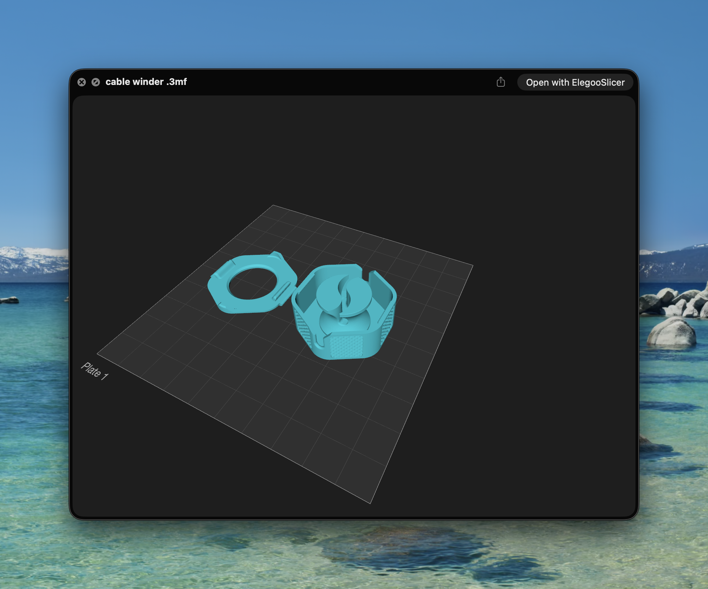

# 3MF Preview

macOS 14+ Quick Look extension with interactive SceneKit rendering.
Select a `.3mf` in Finder and press Space. Drag to orbit; scroll to zoom.



Verified in Finder on macOS 26.5.1 (Apple Silicon).

Supports meshes, build transforms, component instances, and production
extension references to other model parts. Renders geometry in teal.
Numbered build plates and grids use the printable area and plate layout
from Bambu/Orca/Elegoo project metadata, including empty plates. Bedless
3MFs remain model-only. Plate placement follows the slicer grid convention.
Textures, material colors, plate selection, and Finder icon thumbnails
are not implemented. This is a local ad-hoc signed build,
not a notarized distribution.

## Build

Requires Xcode and XcodeGen (`brew install xcodegen`).

```sh
./script/build_and_run.sh --build
./script/build_and_run.sh
./script/test.sh
```

Build products live in `/private/tmp/ThreeMFPreview-build` to avoid iCloud
metadata invalidating signatures. Tests require access to macOS graphics
services. Eight fixtures cover meshes, cross-part transforms, invalid indices,
cycles, empty builds, corrupt archives, four-plate layouts, and invalid
bed metadata. The renderer writes `Tests/preview.png` and `Tests/plates.png`.

## Install

Build the app, then copy it from
`/private/tmp/ThreeMFPreview-build/Build/Products/Debug/ThreeMFPreview.app`
to `~/Applications`. Open it once, then enable its Quick Look extension under
System Settings → General → Login Items & Extensions if necessary.

```sh
pluginkit -a ~/Applications/ThreeMFPreview.app/Contents/PlugIns/Preview.appex
pluginkit -e use -i com.local.ThreeMFPreview.Preview
qlmanage -r
```

Keep the app installed: it contains the extension. Other apps can declare
different type identifiers for 3MF; this build registers
`org.3mf.3dmanufacturing`. Add any conflicting identifier to
`QLSupportedContentTypes` in `Preview/Info.plist` if needed.

## Structure

```text
Host / Quick Look controller
            |
        ModelLoader -> SceneKit scene -> Viewer
            |
      XML model resources
            |
    Package (libarchive, memory only)
```

Limits: 256 MiB decoded model XML, 4,096 archive entries, 3 million
triangles per mesh, 20,000 instances, and 64 component levels.

API: https://developer.apple.com/documentation/quicklookui/qlpreviewingcontroller
Format: https://github.com/3MFConsortium/spec_core

Plate grid reference: https://github.com/OrcaSlicer/OrcaSlicer/blob/main/src/slic3r/GUI/PartPlate.cpp
